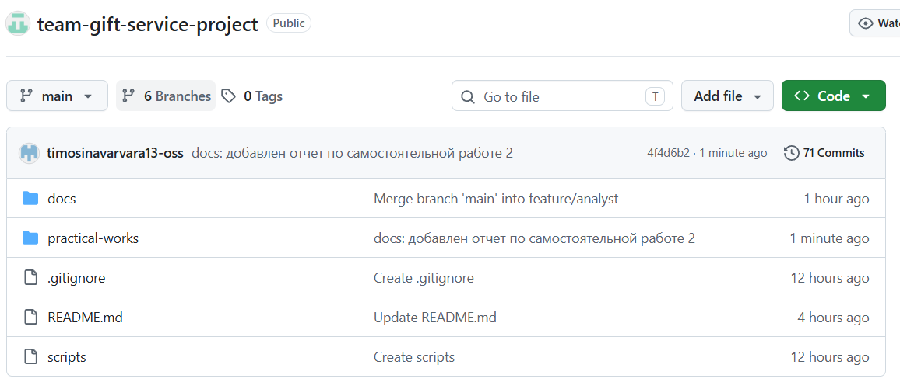
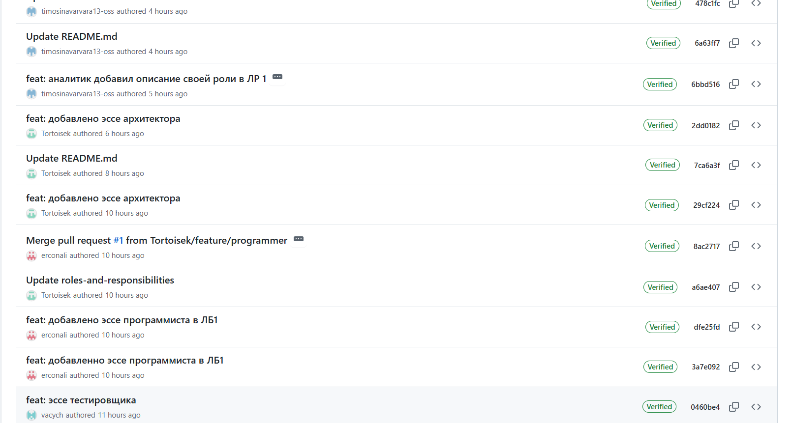
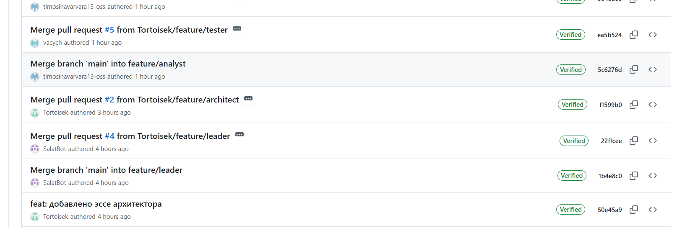

# Отчет по самостоятельной работе №2
## Организация работы с репозиторием проекта и распределение ответственности в Git

**Команда:** team-gift-service-project

**Название проекта:** Сервис подбора подарков

### 1. Подтверждение регистрации участников на GitHub

Все участники команды прошли регистрацию на платформе GitHub. Список логинов:

1. Андреев Андрей (Руководитель) — SalatBot
2. Гришунькина Виктория (Архитектор ПО) — Tortoisek
3. Лукашина Анна (Программист) — erconali
4. Тимошина Варвара (Специалист по данным) — timosinavarvara13-oss
5. Евдокимова Василисса (Тестировщик) — vacych

### 2. Ссылка на командный репозиторий

Репозиторий проекта доступен по ссылке: 
https://github.com/Tortoisek/team-gift-service-project

### 3. Структура репозитория

В рамках работы была организована строгая структура папок, соответствующая требованиям методички. Все практические работы, документация и вспомогательные скрипты хранятся в изолированных директориях.

### 4. Распределение обязанностей по работе с репозиторием

В соответствии с матрицей ответственности, разработанной в первой самостоятельной работе, обязанности по работе с Git-репозиторием распределены следующим образом:

**1. Создание и настройка репозитория**
*   **Ответственный (R):** Руководитель разработки.
*   **Утверждающий (A):** Руководитель разработки.
*   Руководитель создает репозиторий на GitHub, настраивает базовые параметры и добавляет участников в качестве коллабораторов.

**2. Поддержание структуры папок и файлов**
*   **Ответственные (R):** Все участники команды.
*   **Утверждающий (A):** Руководитель разработки.
*   Каждый участник следит за тем, чтобы создаваемые им файлы и папки соответствовали утвержденной структуре проекта и находились в правильных директориях.

**3. Написание отчетов по практическим работам**
*   **Ответственные (R):** Все участники команды.
*   **Утверждающий (A):** Руководитель разработки.
*   Каждый участник пишет свою часть отчета (в соответствии со своей ролью) в файлы `report.md` внутри папок практических работ.

**4. Внесение коммитов с осмысленными сообщениями**
*   **Ответственные (R):** Каждый участник за свои изменения.
*   **Утверждающий (A):** Руководитель разработки.
*   Участники фиксируют изменения в Git, используя понятные сообщения (например, с префиксами `feat:`, `docs:`, `fix:`), отражающие суть проделанной работы.

**5. Проверка пул-реквестов (Pull Request)**
*   **Ответственные (R):** Руководитель разработки, Архитектор ПО.
*   **Утверждающий (A):** Руководитель разработки.
*   Перед слиянием изменений в основную ветку, назначенные участники проверяют код и тексты на соответствие требованиям и отсутствие ошибок.

**6. Слияние веток (Merge)**
*   **Ответственный (R):** Руководитель разработки.
*   **Утверждающий (A):** Руководитель разработки.
*   После успешного прохождения ревью и разрешения конфликтов, руководитель выполняет слияние рабочей ветки с основной веткой `main`.

**7. Резервное копирование и поддержание актуальности**
*   **Ответственные (R):** Все участники команды.
*   **Утверждающий (A):** Руководитель разработки.
*   Участники регулярно синхронизируют свои локальные копии репозитория с удаленной версией (`git pull`), чтобы работать с актуальными данными.

### 5. История коммитов и вклад участников

В ходе работы каждый участник вносил изменения в репозиторий через отдельные коммиты. Это позволяет отследить вклад каждого члена команды.

### 6. Pull Request и процесс ревью

Для слияния изменений в основную ветку использовались Pull Request. Процесс включал создание запроса, проверку изменений (Review) и последующее слияние (Merge).

### 7. Вывод

В ходе самостоятельной работы №2 была организована командная работа с использованием системы контроля версий Git. Освоены базовые навыки работы с репозиторием: клонирование, создание веток, коммиты, создание Pull Request и слияние изменений. 

Использование Git позволило организовать совместную работу, четко зафиксировать вклад каждого участника через историю коммитов и обеспечить сохранность всех материалов проекта в структурированном виде. Распределение ответственности на основе матрицы RACI исключило дублирование задач и сделало процесс разработки прозрачным для всей команды.
