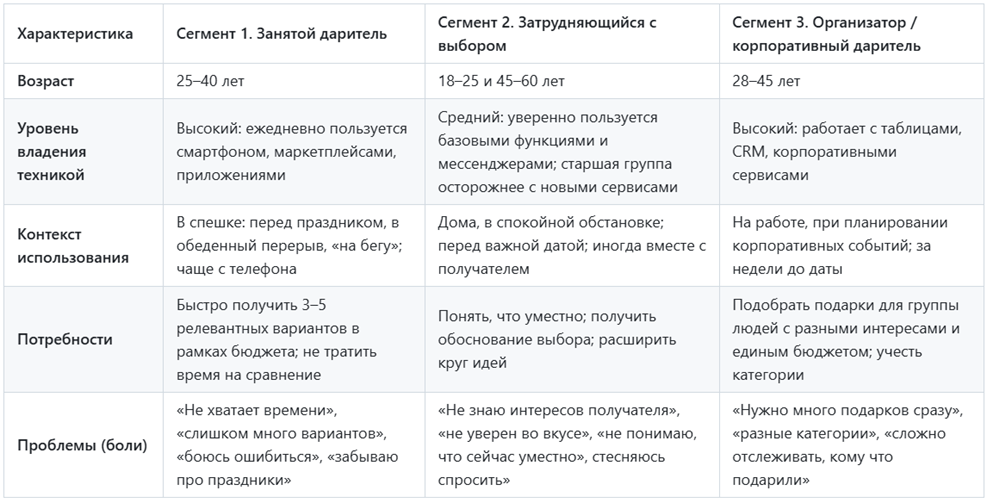

# Самостоятельная работа 3. Определение целевой аудитории

## 1. Сегменты целевой аудитории с обоснованием

В ходе работы были проанализированы ситуации, в которых люди ищут подарки, и на основе этого выделены три сегмента пользователей.

### Сегмент 1. «Занятой» (основной сегмент)

Данный сегмент является основным, так как именно эти пользователи чаще всего сталкиваются с проблемой выбора подарка и при этом готовы пользоваться цифровым сервисом. Это люди 25–40 лет, которые регулярно дарят подарки — коллегам, друзьям, родственникам, партнёру, — но не имеют времени на длительный поиск. Они тратят много времени на маркетплейсы и всё равно сомневаются в выборе. Аудитория платёжеспособна, поэтому на неё ориентирована монетизация сервиса.

### Сегмент 2. «Затрудняющийся с выбором» (вторичный сегмент)

К этому сегменту относятся люди 18–25 лет (студенты, молодые специалисты) и 45+, которые плохо знают интересы получателя или не уверены в своём вкусе. Для них важна не скорость, а подсказка и снятие тревоги «правильный ли подарок я выбрал». Они менее платёжеспособны, но создают массовый трафик и формируют отзывы о сервисе.

### Сегмент 3. «Организатор / корпоративный даритель» (потенциальный сегмент)

К данному сегменту относятся HR-специалисты, тимлиды и организаторы мероприятий, которые подбирают подарки для групп людей — коллегам на праздники, участникам конференций, партнёрам. Им необходим массовый подбор с учётом бюджета и категорий получателей. Сегмент перспективен для монетизации, но требует отдельных функций, поэтому рассматривается как направление развития, а не как приоритет первой версии.

## 2. Таблица характеристик сегментов

## 3. Портреты пользователей

### Портрет 1. «Занятой» — Марина, 31 год

> «У меня нет времени ходить по магазинам, а дарить что-то “лишь бы что-то” не хочется».

**Кто:** менеджер проектов в IT-компании, замужем, есть ребёнок. Живёт в крупном городе. Доход средний+. Смартфон — основной инструмент.

**Как проходит день:** утром созвоны, днём задачи, вечером семья. За три дня до дня рождения коллеги вспоминает, что нужен подарок. Открывает маркетплейс, листает десятки страниц, сравнивает отзывы, устаёт, покупает «что-то популярное» и всё равно сомневается.

**Потребности:** быстро получить 3–5 подходящих вариантов с фильтрами по бюджету и поводу, желательно со ссылкой «купить» и коротким обоснованием, почему это подойдёт.

**Боли:** нехватка времени, перегрузка вариантами, страх ошибиться, забывчивость про даты.

**Что ждёт от сервиса:** минимум шагов, понятный интерфейс, подсказки, возможность сохранить получателя и историю подарков. Готова пользоваться с телефона и платить за премиум (напоминания, подборки).

### Портрет 2. «Затрудняющийся с выбором» — Максим, 21 год (студент)

> «Хочу подарить что-то нормальное, но не понимаю, что ей понравится, и боюсь выглядеть глупо».

**Кто:** студент 3 курса, подрабатывает. Бюджет ограничен (до 2000₽). Пользуется смартфоном и мессенджерами.

**Ситуация:** приближается день рождения девушки / мамы / друга. Точных интересов не знает или сомневается, уместен ли подарок. Спрашивать напрямую неловко. Ищет в интернете «что подарить…», читает статьи, но они слишком общие.

**Потребности:** понятные вопросы-подсказки (возраст, повод, интересы, бюджет), варианты с объяснением «почему это подойдёт», визуальные карточки.

**Боли:** неуверенность, страх показаться невнимательным, ограниченный бюджет, непонимание «что уместно».

**Что ждёт от сервиса:** простой пошаговый подбор, бесплатный базовый функционал. Ценит объяснения и примеры. Лоялен к сервису, который «помог не опозориться».

### Портрет 3. «Организатор / корпоративный даритель» — Елена, 36 лет (HR)

> «Мне нужно закрыть подарки на 40 человек к Новому году, и чтобы никто не остался без внимания и в рамках бюджета».

**Кто:** HR-специалист в компании среднего размера. Работает за компьютером, использует Excel, корпоративные сервисы. Отвечает за корпоративные праздники и подарки сотрудникам и партнёрам.

**Ситуация:** за месяц до праздника формирует список получателей по категориям (сотрудники, руководители, партнёры) с разными бюджетами. Нужно подобрать подарки быстро, учесть интересы хотя бы частично, не выйти за бюджет и не повторяться.

**Потребности:** массовый подбор, категории получателей, фильтр по бюджету, экспорт списка, возможность сохранить и сравнить варианты, история подарков по сотрудникам.

**Боли:** разные бюджеты, риск повторов и ошибок, сложно отслеживать, кому что уже подарили.

**Что ждёт от сервиса:** веб-версия, списки, шаблоны подборок, отчёты. Готова к платному тарифу / корпоративной подписке.

## 4. Единое видение целевой аудитории в команде

В результате обсуждения команда зафиксировала следующее видение целевой аудитории:

- **Основной пользователь сервиса — «занятой» (25–40 лет)**, который ценит скорость. На него ориентированы интерфейс, сценарий подбора и монетизация (премиум-подписка).
- **Второй по важности сегмент — «затрудняющийся с выбором»**, для которого критичны пошаговый опрос, объяснения. Он обеспечивает массовость и лояльность.
- **Третий сегмент — «организатор / корпоративный даритель»** рассматривается как перспективное направление развития, для которого в будущем появятся веб-версия, списки и экспорт.

**Общее видение:** сервис создаётся в первую очередь для частных пользователей (сегменты 1 и 2), с простым мобильным интерфейсом, пошаговым подбором и понятными объяснениями. Корпоративный сегмент учитывается при проектировании архитектуры (возможность списков и массового подбора), но приоритетом первой версии он не является.

## 5. Вывод: как особенности аудитории повлияют на будущий продукт

1. **Минимум шагов.** Сегмент 1 пользуется сервисом «на бегу» с телефона — значит, ключевые сценарии должны укладываться в 3–5 экранов и не требовать ввода большого объёма данных.

2. **Пошаговый подбор с объяснениями.** Сегмент 2 не уверен в выборе — сервису нужны подсказки, вопросы о получателе (возраст, повод, интересы, бюджет) и короткое обоснование «почему этот подарок подойдёт».

3. **Фильтры по бюджету и поводу — обязательны.** Бюджет критичен для всех сегментов (особенно для студентов и корпоративных закупок), повод определяет уместность подарка.

4. **Сохранение получателей и история подарков.** Снимает проблему «забыл, что дарил» и «кому что подарили», важна для сегментов 1 и 3.

5. **Разделение бесплатного и платного функционала.** Базовый подбор — бесплатно (для сегмента 2), премиум (напоминания, расширенные подборки, экспорт) — для сегмента 1 и корпоративных пользователей.

6. **Заложить основу для экспорта списка подарков.** Даже в первой версии стоит предусмотреть возможность работы со списками получателей и категориями — это упростит развитие в сторону сегмента 3.

7. **Доступность и простота освоения.** Учитывая разный уровень владения техникой (в т.ч. пользователи 45+), интерфейс должен быть интуитивным, с крупными элементами и подсказками.

## Общий вывод о целевой аудитории

Таким образом, целевой аудиторией сервиса подбора подарков являются люди, которым нужно выбрать подарок, но при этом не хватает времени, знаний об интересах получателя или уверенности в собственном выборе. Ядро аудитории составляют частные пользователи в возрасте примерно от 18 до 50 лет: с одной стороны, работающие люди 25–40 лет, ценящие скорость и удобство, с другой — студенты и пользователи старшего возраста, которым важны подсказки и обоснование выбора. Дополнительно в качестве перспективного направления рассматриваются корпоративные пользователи, подбирающие подарки для групп людей. Приоритетом первой версии сервиса являются частные пользователи, а корпоративный сегмент учитывается при развитии продукта.

