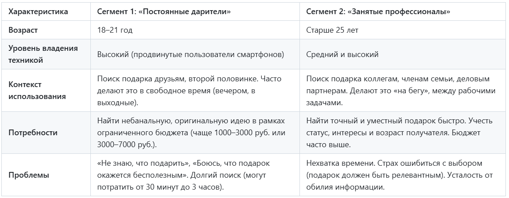

# Отчет по самостоятельной работе №3

## Определение целевой аудитории сервиса «Сервис подбора подарков»

### 1. Перечень сегментов целевой аудитории с обоснованием

На основе проведенного опроса (20 респондентов) были выделены два основных сегмента целевой аудитории нашего сервиса:

1. **«Постоянные дарители» (Молодежь и студенты 18-21 год).** Это самый крупный сегмент по результатам опроса (около 80% респондентов). Они часто сталкиваются с необходимостью выбора подарков (друзьям, партнерам, родителям) и активно используют цифровые сервисы для поиска идей.
2. **«Занятые профессионалы» (Люди старше 25-35 лет).** Несмотря на то, что в опросе их меньше, это платежеспособная аудитория. Они ценят свое время, поэтому им важно быстро получить точную рекомендацию, а не тратить часы на маркетплейсы.

### 2. Таблица характеристик каждого сегмента

### 3. Портреты пользователей

#### Портрет 1: «Постоянный даритель» (Студент)

*   **Имя:** Анна, 19 лет.
*   **Деятельность:** Студентка университета.
*   **Цели:** Найти классный и недорогой подарок для лучшей подруги на день рождения или для парня на годовщину. Хочет удивить, а не дарить банальности (кружки, носки).
*   **Боли:** Перебирает маркетплейсы (Ozon, Wildberries) часами, но все кажется скучным. Боится, что подарок будет бесполезным. Бюджет ограничен (до 3000 рублей).
*   **Как наш сервис помогает:** Сервис предложит небанальные варианты в рамках бюджета, основываясь на интересах получателя (например, хобби или любимые фильмы). Это сэкономит ей время и нервы.

#### Портрет 2: «Занятой профессионал»

*   **Имя:** Дмитрий, 32 года.
*   **Деятельность:** Менеджер в компании, женат.
*   **Цели:** Быстро выбрать подарок для жены на годовщину или для коллеги на Новый год. У него нет времени ходить по магазинам.
*   **Боли:** Постоянная нехватка времени. Не хочет выглядеть глупо, подарив неуместную вещь. Готов заплатить за сервис, который избавит его от мук выбора (готов на разовую оплату).
*   **Как наш сервис помогает:** Сервис быстро проанализирует параметры (возраст, пол, повод) и выдаст 3-5 точных рекомендаций, которые можно сразу купить.

### 4. Вывод о том, как особенности аудитории влияют на будущий продукт

Анализ целевой аудитории показал, что наш продукт должен решать две главные проблемы: **«Не знаю, что подарить»** и **«Нет времени на выбор»**. 

Основываясь на опросе (где большинство готовы пользоваться сервисом бесплатно, но есть и те, кто готов платить за разовый подбор), мы делаем вывод:
1.  **Интерфейс** должен быть интуитивно понятным и быстрым (минимум кликов до результата), ориентированным на мобильные устройства, так как большинство пользователей — молодежь.
2.  **Алгоритм** должен выдавать *оригинальные* и *точные* рекомендации (это важнее всего для 90% опрошенных). Просто «список товаров» не подойдет — нужны идеи, которых нет на первом месте в поиске маркетплейсов.
3.  **Монетизация:** Продукт должен иметь бесплатный базовый функционал, но может предлагать платную «разовую оплату за подбор» (как показал опрос, часть пользователей готова на это).
