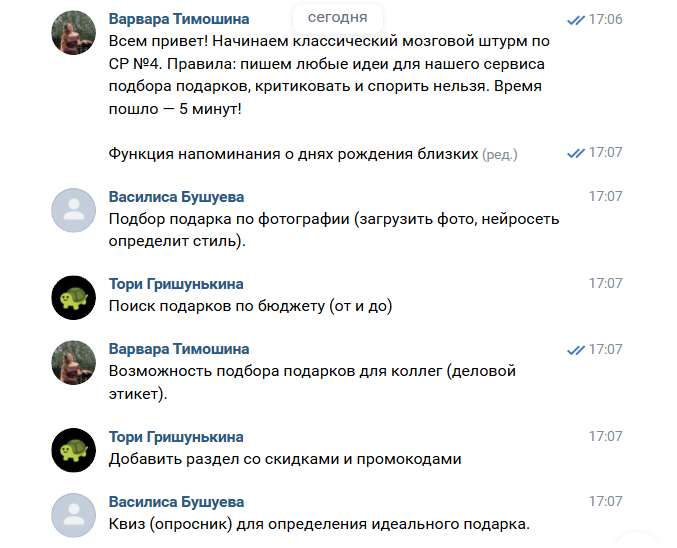
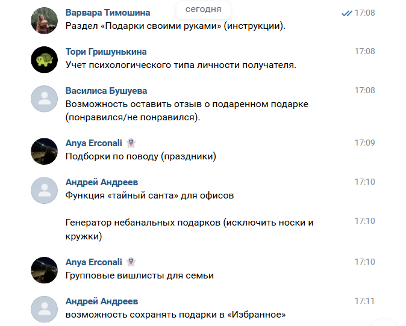

# Отчет по самостоятельной работе №4
## Выявление функциональных требований методом мозгового штурма

### 1. Описание проведения мозгового штурма

Для выявления функциональных требований к сервису «Сервис подбора подарков» командой был проведен **классический мозговой штурм**. 

*   **Участники:** Вся команда проекта (5 человек).
*   **Правила:** Запрещена любая критика идей на этапе генерации. Приветствуются любые, даже самые фантастические предложения. Главная цель — собрать как можно больше идей за короткое время.
*   **Длительность:** 5 минут.
*   **Формат проведения:** В связи с дистанционным форматом работы, штурм проводился в общем чате команды в социальной сети ВКонтакте.

### 2. Полный список сгенерированных идей

В ходе мозгового штурма участниками были предложены следующие идеи (без цензуры и отбора):

1. Функция напоминания о днях рождения близких.
2. Подбор подарка по фотографии (загрузить фото, нейросеть определит стиль).
3. Поиск подарков по бюджету (от и до).
4. Возможность подбора подарков для коллег (деловой этикет).
5. Добавить раздел со скидками и промокодами.
6. Квиз (опросник) для определения идеального подарка.
7. Раздел «Подарки своими руками» (инструкции).
8. Учет психологического типа личности получателя.
9. Возможность оставить отзыв о подаренном подарке (понравился/не понравился).
10. Подборки по поводу (праздники).
11. Функция «Тайный Санта» для офисов.
12. Генератор небанальных подарков (исключить носки и кружки).
13. Групповые вишлисты для семьи.
14. Возможность сохранять подарки в «Избранное».
15. Подбор подарков для адвент-календаря.

### 3. Результат группировки и отбора идей (с обоснованием)

После завершения генерации команда провела анализ и сгруппировала идеи по направлениям. Были отобраны наиболее значимые для первой версии продукта (MVP).

**Группа 1: Ядро сервиса (Поиск и рекомендации)**
Отобрано: Учет психологического типа (8), Поиск по бюджету (3), Генератор небанальных подарков (12).
Обоснование: Это главная ценность продукта. Пользователь приходит, чтобы получить точную рекомендацию, учитывающую его бюджет и интересы получателя.

**Группа 2: Удобство и вовлечение (User Experience)**
Отобрано: Квиз для определения подарка (6), Сохранение в «Избранное» (14), Напоминания о днях рождения (1), Групповые вишлисты (13).
Обоснование: Эти функции повышают возвращаемость пользователей и делают взаимодействие с сервисом более простым.

**Группа 3: Монетизация и партнерство**
Отобрано: Раздел со скидками и промокодами (5).
Обоснование: Поможет монетизировать проект за счет партнерских программ магазинов.

**Отклонено (для будущих версий):** Подбор по астрологии, подбор по фото, «Тайный Санта», адвент-календарь. Эти идеи интересны, но требуют сложной технической реализации или пока не так востребованы целевой аудиторией.

### 4. Итоговый перечень функциональных требований

На основе отобранных идей сформированы следующие функциональные требования к сервису:

1.  Сервис должен предоставлять форму для ввода параметров получателя (возраст, пол, интересы/хобби, бюджет, повод).
2.  Сервис должен иметь базу данных подарков с возможностью фильтрации по заданным параметрам.
3.  Алгоритм сервиса должен выдавать не менее 5 оригинальных вариантов подарков (исключая банальные варианты).
4.  Для каждого предложенного подарка должна быть ссылка на покупку на маркетплейсе (партнерская интеграция).
5.  Пользователь должен иметь возможность добавлять понравившиеся варианты в раздел «Избранное».
6.  В сервисе должен быть реализован интерактивный квиз (опросник) для тех, кто не знает параметров получателя.
7.  Сервис должен предусматривать возможность создания напоминаний о предстоящих праздниках.

### 5. Вывод

Проведение классического мозгового штурма позволило команде быстро сгенерировать широкий спектр идей, ориентируясь на ранее выявленную целевую аудиторию. 

Группировка идей помогла отделить ключевые функции (поиск и рекомендации) от второстепенных. Итоговый перечень функциональных требований полностью закрывает базовые потребности пользователей, выявленные на этапе анализа аудитории: экономию времени на поиск, учет бюджета и получение небанальных, полезных рекомендаций.

