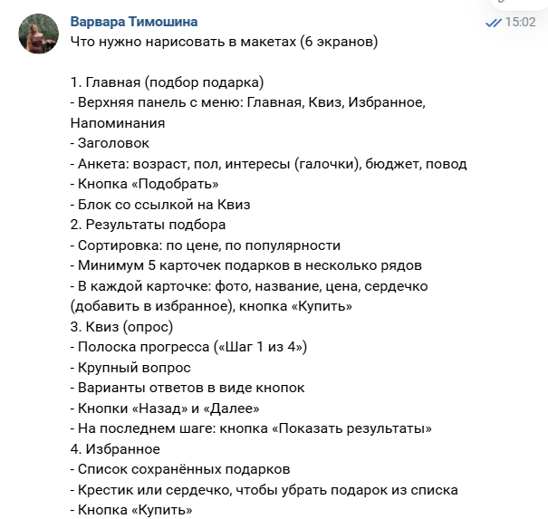
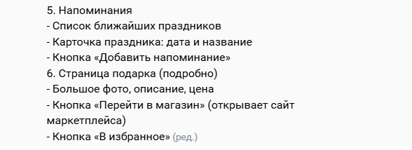
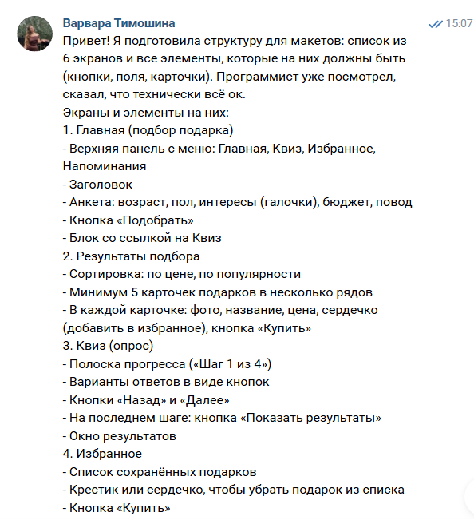
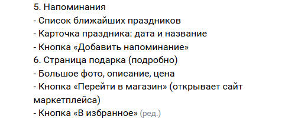
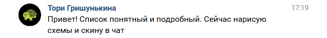
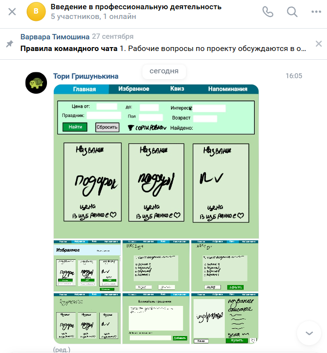
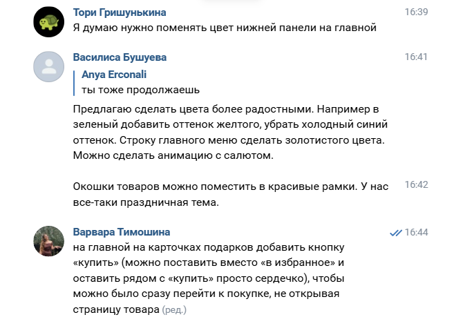
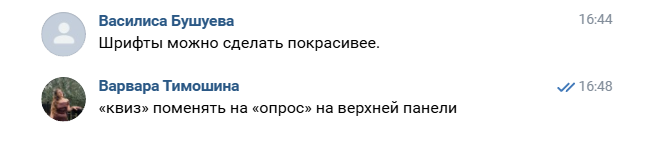

# Отчет: Специалист по данным (аналитик)

## 1. Введение

В рамках текущей работы нашей команде нужно было создать интерфейс для сайта, который подбирает подарки. Моя задача заключалась в том, чтобы придумать, какие именно экраны (страницы) будут на сайте, и что конкретно на них будет находиться. Я взяла наши общие идеи, проанализировала их и расписала список экранов и элементов для них. Этот список стал основой для работы архитектора.

## 2. Перечень функций сайта 

В самостоятельной работе №4 мы решили, что наш сервис должен уметь следующее:
1. Принимать параметры получателя (возраст, пол, интересы, бюджет, повод).
2. Иметь базу подарков с возможностью фильтрации.
3. Выдавать не менее 5 оригинальных вариантов (без банальностей).
4. Давать ссылку на покупку подарка на маркетплейсе.
5. Позволять добавлять подарки в раздел «Избранное».
6. Проводить интерактивный квиз для тех, кто не знает параметров получателя.
7. Создавать напоминания о предстоящих праздниках.

## 3. Список экранов и элементов интерфейса

Чтобы эти функции работали, я продумала, как именно они будут реализованы на экранах. Например, для приема параметров нужна анкета с полями и галочками, для выдачи вариантов ー сетка карточек с кнопками, а для напоминаний ー отдельный список с датами. На основе этого я составила структуру из 6 основных экранов:

### 1. Главная (подбор подарка)
- Верхняя панель с меню: Главная, Квиз, Избранное, Напоминания
- Анкета: возраст, пол, интересы (галочки), бюджет, повод
- Кнопка «Подобрать» 
- Яркий блок со ссылкой на Квиз (опрос)

### 2. Результаты подбора
- Сортировка: по цене, по популярности
- Минимум 5 карточек подарков в несколько рядов
- В каждой карточке: фото, название, цена, сердечко (добавить в избранное), кнопка «Купить»

### 3. Квиз (опрос)
- Полоска прогресса («Шаг 1 из 4»)
- Крупный вопрос
- Варианты ответов в виде кнопок
- Кнопки «Назад» и «Далее»
- На последнем шаге: кнопка «Показать результаты»

### 4. Избранное
- Список сохранённых подарков
- Крестик или сердечко, чтобы убрать подарок из списка
- Кнопка «Купить»

### 5. Напоминания
- Список ближайших праздников
- Карточка праздника: дата и название
- Кнопка «Добавить напоминание»

### 6. Страница подарка (подробно)
- Большое фото, описание, цена
- Кнопка «Перейти в магазин» (открывает сайт маркетплейса)
- Кнопка «В избранное»

## 4. Взаимодействие с командой

Для того чтобы работа шла слаженно, мы всё обсуждали в командном чате. Вот что я делала:

- **Общалась с программистом:** отправила ему свой список экранов и функций. Он сказал, что структура подходит.
 
<table>
  <tr>
    <td></td>
    <td></td>
    <td></td>
  </tr>
</table>
 

- **Передала задачу архитектору:** отправила ему список элементов, чтобы он нарисовал черновые схемы экранов.
 
<table>
  <tr>
    <td></td>
    <td></td>
    <td></td>
  </tr>
</table>
 

- **Участвовала в общем обсуждении:** когда тестировщик давал свои правки, я тоже писала своё мнение.
 
<table>
  <tr>
    <td></td>
    <td></td>
    <td></td>
  </tr>
</table>

## 5. Вывод

В итоге я составила четкую структуру из 6 экранов, расписала все элементы и функции. Это помогло нашей команде перейти от абстрактных идей к конкретным макетам и избежать путаницы в работе. Мой список полностью покрывает все функции, которые мы придумали на предыдущем этапе.

